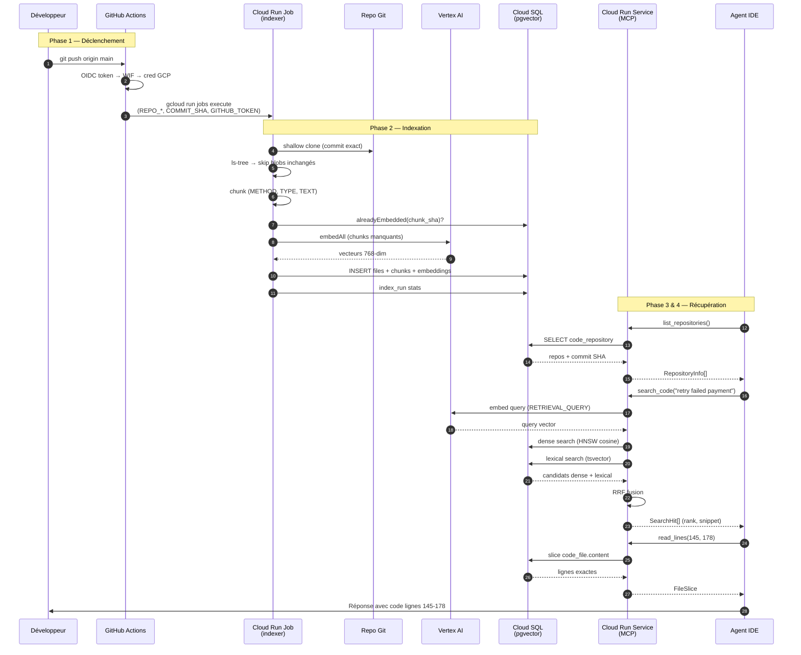

# Workflow complet — du push GitHub à la récupération de code via MCP

> Ce document décrit le parcours end-to-end : un développeur pousse du code sur GitHub,
> l'index est mis à jour, et un agent IDE récupère le bout de code concerné via le serveur MCP.

---

## Vue d'ensemble en 4 phases

```
 Phase 1          Phase 2           Phase 3            Phase 4
 DÉCLENCHEMENT    INDEXATION        STOCKAGE           RÉCUPÉRATION
 ─────────────    ──────────        ────────           ────────────
 push GitHub  →   Cloud Run Job  →  pgvector DB   →   MCP Server  →  IDE Agent
 (CI pipeline)    clone+chunk+embed                  search+read
```

---

## Phase 1 — Déclenchement (GitHub Actions)

### Prérequis côté repo applicatif

Le repo métier appelle le workflow réutilisable (`.github/workflows/code-rag.yml`) :

```yaml
name: code-rag
on:
  push:
    branches: [main]
permissions:
  id-token: write
  contents: read
jobs:
  index:
    uses: YOUR_GITHUB_USER/code-rag/.github/workflows/code-rag-index.yml@main
    with:
      repo_slug: YOUR_GITHUB_USER/order-service
    secrets: inherit
```

Variables GitHub Actions (configurées une fois par repo) :

| Variable | Exemple | Rôle |
|---|---|---|
| `CODE_RAG_GCP_PROJECT` | `my-gcp-project` | Projet GCP |
| `CODE_RAG_GCP_REGION` | `europe-west1` | Région Cloud Run |
| `CODE_RAG_JOB_NAME` | `code-rag-indexer` | Nom du Cloud Run Job |
| `CODE_RAG_WIF_PROVIDER` | `projects/.../providers/github-oidc` | Provider WIF |
| `CODE_RAG_SERVICE_ACCOUNT` | `code-rag-ci@...` | SA avec permission `run.jobs.run` |

### Séquence détaillée

```
Développeur                    GitHub Actions                   Google Cloud
    │                              │                              │
    │  git push origin main        │                              │
    │─────────────────────────────>│                              │
    │                              │                              │
    │                              │  Job `.code-rag-index`       │
    │                              │  (continue-on-error: true) │
    │                              │                              │
    │                              │  1. Génère OIDC token        │
    │                              │     (id-token: write)       │
    │                              │                              │
    │                              │  2. Échange OIDC → cred GCP  │
    │                              │     (Workload Identity       │
    │                              │      Federation)             │
    │                              │─────────────────────────────>│
    │                              │                              │
    │                              │  3. gcloud run jobs execute  │
    │                              │     code-rag-indexer         │
    │                              │     --update-env-vars:       │
    │                              │       REPO_SLUG              │
    │                              │       REPO_URL               │
    │                              │       REPO_BRANCH            │
    │                              │       COMMIT_SHA  ← exact    │
    │                              │       GIT_USERNAME           │
    │                              │       GIT_TOKEN=GITHUB_TOKEN│
    │                              │─────────────────────────────>│
    │                              │                              │
    │                              │  4. Attend fin du job        │
    │                              │     (--wait)                 │
    │                              │<─────────────────────────────│
    │                              │                              │
    │  merge non bloqué            │  exit 0 ou 1                 │
    │  (continue-on-error: true) │  (index stale si échec)      │
```

### Points importants

- **Pas de webhook GitHub** — le déclenchement passe par le workflow GitHub Actions
- **Commit exact, pas la branche** — un job en queue indexe le SHA qui l'a déclenché
- **Branche default uniquement** — les feature branches ne sont pas indexées
- **continue-on-error: true** — un échec d'indexation ne bloque jamais un merge
- **GITHUB_TOKEN** — permet le clone git, expire à la fin du job
- **Aucun credential sensible** sur le runner GitHub

---

## Phase 2 — Indexation (Cloud Run Job)

### Entrée du job

Le `IndexerJobRunner` lit les variables d'environnement et appelle `IndexService.run()`.

```
Cloud Run Job: code-rag-indexer
├── REPO_SLUG=acme/order-service
├── REPO_URL=https://github.com/YOUR_GITHUB_USER/order-service.git
├── REPO_BRANCH=main
├── COMMIT_SHA=abc123def456...
├── GIT_USERNAME=x-access-token
└── GIT_TOKEN=<GITHUB_TOKEN éphémère>
```

### Pipeline d'indexation détaillé

```
┌─────────────────────────────────────────────────────────────────┐
│                     IndexService.run()                          │
└─────────────────────────────────────────────────────────────────┘
                              │
                              ▼
┌─────────────────────────────────────────────────────────────────┐
│ 1. CLONE GIT                                                    │
│    GitClient.cloneShallow(url, commitSha)                       │
│    • shallow clone (--depth 1)                                  │
│    • checkout exact du COMMIT_SHA                               │
│    • auth via GIT_ASKPASS (token, pas de shell)                 │
└─────────────────────────────────────────────────────────────────┘
                              │
                              ▼
┌─────────────────────────────────────────────────────────────────┐
│ 2. INVENTAIRE FICHIERS                                          │
│    git ls-tree -r HEAD                                          │
│    → Map<path, blobSha> pour chaque fichier                     │
│                                                                 │
│    Filtres appliqués :                                          │
│    • extensions indexables (.java, .kt, .ts, .go, .cs, ...)     │
│    • taille max (ex. 512 KB)                                    │
│    • dossiers exclus (node_modules, target, .git, ...)          │
└─────────────────────────────────────────────────────────────────┘
                              │
                              ▼
┌─────────────────────────────────────────────────────────────────┐
│ 3. DÉDUPLICATION FICHIER (niveau 1)                             │
│    Pour chaque fichier :                                        │
│    if blobSha == dernier blobSha connu en DB → SKIP            │
│    Sinon → lire le contenu du disque                            │
└─────────────────────────────────────────────────────────────────┘
                              │
                              ▼
┌─────────────────────────────────────────────────────────────────┐
│ 4. CHUNKING (BraceStructuralChunker via ChunkerRouter)          │
│                                                                 │
│    OrderService.java (400 lignes, 12 méthodes)                  │
│    ├── TYPE chunk   : class OrderService { ... signatures ... } │
│    ├── METHOD chunk : findById(...) { corps complet }           │
│    ├── METHOD chunk : cancel(...) { corps complet }             │
│    └── TEXT chunk   : package + imports                         │
│                                                                 │
│    Chaque chunk reçoit :                                        │
│    • chunk_sha = SHA-256(texte normalisé)                       │
│    • symbol, signature, startLine, endLine, kind                │
│    • lexical tsvector (pour recherche full-text)                  │
└─────────────────────────────────────────────────────────────────┘
                              │
                              ▼
┌─────────────────────────────────────────────────────────────────┐
│ 5. DÉDUPLICATION CHUNK (niveaux 2 & 3)                          │
│    SELECT chunk_sha FROM code_embedding                         │
│    WHERE chunk_sha IN (...) AND model_id = 'gemini-...'        │
│                                                                 │
│    Chunks déjà embeddés → chunks_reused++                       │
│    Chunks nouveaux       → file d'attente pour Vertex AI        │
└─────────────────────────────────────────────────────────────────┘
                              │
                              ▼
┌─────────────────────────────────────────────────────────────────┐
│ 6. EMBEDDING (Vertex AI — hors transaction DB)                  │
│                                                                 │
│    VertexAiEmbeddingModel                                       │
│    • taskType = RETRIEVAL_DOCUMENT                              │
│    • model = gemini-embedding-001                               │
│    • dimension = 768 (L2-normalisé)                             │
│                                                                 │
│    embedAll(nouveaux chunks par batch de ~400)                  │
│    → chunks_embedded++                                          │
└─────────────────────────────────────────────────────────────────┘
                              │
                              ▼
┌─────────────────────────────────────────────────────────────────┐
│ 7. ÉCRITURE DB (IndexWriteRepository)                           │
│                                                                 │
│    INSERT code_file (content, blob_sha, ...)                    │
│    INSERT code_chunk (line ranges, symbol, lexical, ...)        │
│    INSERT code_embedding (chunk_sha, model_id, vector)          │
│         ON CONFLICT DO NOTHING                                  │
│    UPDATE code_repository (last_commit_sha, stats)              │
│    INSERT index_run (embedded, reused, duration, ...)           │
└─────────────────────────────────────────────────────────────────┘
                              │
                              ▼
                         exit 0
```

### Exemple concret

Commit modifiant **une seule méthode** dans une classe de 40 méthodes :

| Étape | Résultat |
|---|---|
| ls-tree | 847 fichiers, 846 blob SHA identiques |
| Fichiers lus | 1 (`PaymentService.java`) |
| Chunks produits | 42 (1 TYPE + 40 METHOD + 1 TEXT) |
| Chunks re-embeddés | **1** (la méthode modifiée) |
| Chunks réutilisés | 41 |
| Appels Vertex AI | **1** |

---

## Phase 3 — Stockage (PostgreSQL + pgvector)

### État de la base après indexation

```sql
-- Repo enregistré
code_repository:
  slug='acme/order-service'
  last_commit_sha='abc123...'
  file_count=847, chunk_count=12400

-- Fichier source (texte unique)
code_file:
  repo_slug='acme/order-service'
  path='src/main/java/com/acme/PaymentService.java'
  blob_sha='def789...'
  content='package com.acme; ...'  -- texte complet
  line_count=312

-- Chunks retrievables
code_chunk:
  repo_slug='acme/order-service'
  path='src/main/java/com/acme/PaymentService.java'
  chunk_index=3
  chunk_sha='a1b2c3...'
  kind='METHOD'
  symbol='PaymentService#retryFailedPayment'
  signature='void retryFailedPayment(PaymentId id)'
  start_line=145, end_line=178
  lexical='retry failed payment ...'  -- tsvector

-- Vecteur content-addressed
code_embedding:
  chunk_sha='a1b2c3...'
  model_id='gemini-embedding-001@768'
  vector=[0.023, -0.041, ...]  -- 768 dimensions
```

### Relations clés

```
code_embedding.chunk_sha  ←──join──→  code_chunk.chunk_sha
code_chunk.(repo_slug, path)  ←──join──→  code_file.(repo_slug, path)
code_file.content  ──→  source pour snippets et read_lines
```

---

## Phase 4 — Récupération via MCP (IDE Agent)

### Configuration IDE

L'IDE (Cursor, Claude Code, etc.) configure le serveur MCP distant :

```json
{
  "mcpServers": {
    "code-rag": {
      "url": "https://code-rag-mcp-xxxxx.run.app/mcp",
      "headers": {
        "Authorization": "Bearer <MCP_READ_TOKEN>"
      }
    }
  }
}
```

Double authentification :
1. **Cloud Run IAM** — token Google Identity du développeur
2. **Bearer MCP_READ_TOKEN** — token applicatif

### Scénario : « Où est implémenté le retry des paiements échoués ? »

```
Agent IDE                         code-rag-mcp                    PostgreSQL / Vertex AI
    │                                  │                                  │
    │  1. list_repositories()          │                                  │
    │─────────────────────────────────>│                                  │
    │                                  │  SELECT * FROM code_repository   │
    │                                  │─────────────────────────────────>│
    │  [{slug: "acme/order-service",   │                                  │
    │    commitSha: "abc123..."}]      │<─────────────────────────────────│
    │<─────────────────────────────────│                                  │
    │                                  │                                  │
    │  Agent vérifie : commitSha       │                                  │
    │  correspond au code local        │                                  │
    │                                  │                                  │
    │  2. search_code(                 │                                  │
    │       query="retry failed        │                                  │
    │                payment",         │                                  │
    │       repo="acme/order-service") │                                  │
    │─────────────────────────────────>│                                  │
    │                                  │                                  │
    │                                  │  a) Embed query                  │
    │                                  │     (RETRIEVAL_QUERY)            │
    │                                  │─────────────────────────────────>│ Vertex AI
    │                                  │<─────────────────────────────────│
    │                                  │                                  │
    │                                  │  b) Dense search (HNSW)          │
    │                                  │     cosine similarity, top 24    │
    │                                  │─────────────────────────────────>│
    │                                  │<─────────────────────────────────│
    │                                  │                                  │
    │                                  │  c) Lexical search (tsvector)    │
    │                                  │     plainto_tsquery, top 24      │
    │                                  │─────────────────────────────────>│
    │                                  │<─────────────────────────────────│
    │                                  │                                  │
    │                                  │  d) RRF fusion                   │
    │                                  │     DefaultContentAggregator     │
    │                                  │                                  │
    │  [{rank: 1,                      │                                  │
    │    path: ".../PaymentService.java│                                  │
    │    startLine: 145, endLine: 178, │                                  │
    │    symbol: "PaymentService#      │                                  │
    │             retryFailedPayment", │                                  │
    │    snippet: "public void retry   │                                  │
    │              FailedPayment..."}] │                                  │
    │<─────────────────────────────────│                                  │
    │                                  │                                  │
    │  3. get_file_outline(            │                                  │
    │       repo="acme/order-service", │                                  │
    │       path=".../PaymentService   │                                  │
    │             .java")              │                                  │
    │─────────────────────────────────>│                                  │
    │                                  │  SELECT chunks WHERE kind IN     │
    │                                  │  (TYPE, METHOD) ORDER BY line    │
    │                                  │─────────────────────────────────>│
    │  {declarations: [                │                                  │
    │    {symbol: "PaymentService",    │                                  │
    │     lines: "1-312"},             │                                  │
    │    {symbol: "PaymentService#     │                                  │
    │     retryFailedPayment",         │                                  │
    │     lines: "145-178"},           │                                  │
    │    ...                           │                                  │
    │  ]}                              │                                  │
    │<─────────────────────────────────│                                  │
    │                                  │                                  │
    │  4. read_lines(                  │                                  │
    │       repo="acme/order-service", │                                  │
    │       path=".../PaymentService   │                                  │
    │             .java",              │                                  │
    │       fromLine=145, toLine=178)  │                                  │
    │─────────────────────────────────>│                                  │
    │                                  │  SELECT string_to_array(         │
    │                                  │    content, E'\n')[145:178]      │
    │                                  │─────────────────────────────────>│
    │  {lines: "public void retry      │                                  │
    │   FailedPayment(PaymentId id) {  │                                  │
    │     ... corps complet ...        │                                  │
    │   }", truncated: false}          │                                  │
    │<─────────────────────────────────│                                  │
    │                                  │                                  │
    │  Agent répond à l'utilisateur    │                                  │
    │  avec le code exact, lignes      │                                  │
    │  145-178 de PaymentService.java  │                                  │
```

### Parcours alternatif : symbole connu

Si l'agent connaît déjà le nom du symbole :

```
find_symbol("retryFailedPayment", repo="acme/order-service")
    → [{path, startLine, endLine, symbol}]  (~50 tokens, pas de code)
    → read_lines(fromLine, toLine)            (corps exact)
```

Plus rapide et moins coûteux que `search_code` quand le nom est approximativement connu.

---

## Diagramme de séquence complet



---

## Latences typiques

| Étape | Durée estimée |
|---|---|
| Job CI (auth + trigger) | 10-30 s |
| Indexation commit moyen (100 fichiers changés) | 1-5 min |
| Indexation commit trivial (1 fichier) | 15-60 s |
| `search_code` (MCP) | 200-800 ms |
| `read_lines` (MCP) | 50-200 ms |
| `find_symbol` (MCP) | 50-150 ms |

L'indexation est **asynchrone** (job CI en `.post`) — le développeur n'attend pas.
L'agent IDE interroge un index potentiellement stale de quelques minutes.

---

## Gestion de l'index stale

```
Agent démarre une session
    │
    ▼
list_repositories()
    │
    ▼
commitSha indexé == commit local ?
    │
    ├── OUI → recherche fiable
    │
    └── NON → résultats décrivent un état antérieur
              → agent informe l'utilisateur
              → push récent pas encore indexé
              → allow_failure peut expliquer un échec CI silencieux
```

Il n'y a pas de mécanisme push/notify — la détection est **pull** par l'agent.

---

## Flux d'erreurs

| Point de défaillance | Impact | Mitigation |
|---|---|---|
| Échec CI indexing | Index stale, merge non bloqué | `allow_failure: true`, monitoring `index_run` |
| Échec Vertex AI | Chunks non embeddés, exit 1 | Retry manuel via re-push ou re-run job |
| Modèle embedding drift | MCP refuse de démarrer | `SchemaGuard` fail-fast au startup |
| Repo slug inconnu | Erreur explicite avec liste des repos | `requireKnownRepo()` dans CodeRagTools |
| Fichier non indexé | Erreur avec suggestion search_code | Messages d'erreur orientés agent |

---

## Résumé du parcours data

```
Code source (Git)
    │
    │  git ls-tree blob SHA
    ▼
Fichiers filtrés
    │
    │  BraceStructuralChunker
    ▼
Chunks (METHOD/TYPE/TEXT) + chunk_sha
    │
    │  Vertex AI RETRIEVAL_DOCUMENT
    ▼
Vecteurs 768-dim (content-addressed)
    │
    │  INSERT pgvector
    ▼
Base indexée (Cloud SQL)
    │
    │  Query agent IDE
    ▼
Embed query (RETRIEVAL_QUERY) + HNSW + tsvector + RRF
    │
    │  rank + snippet + line range
    ▼
read_lines → code exact retourné à l'agent
```
